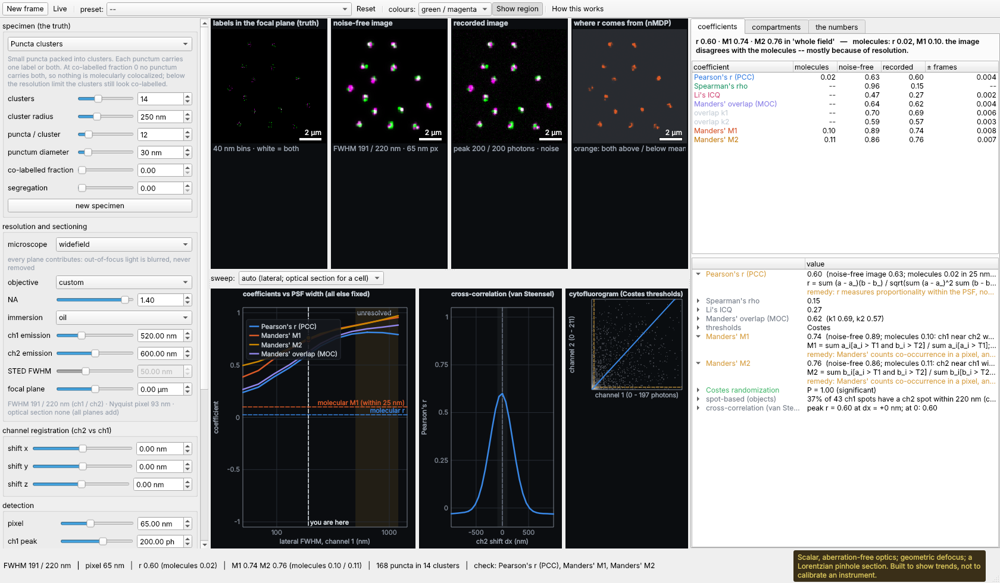
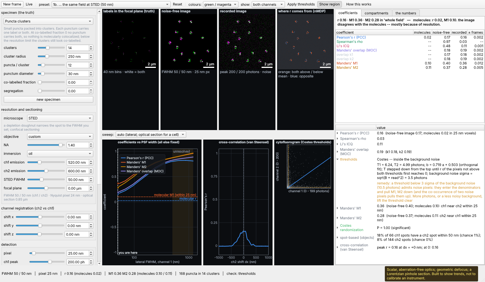
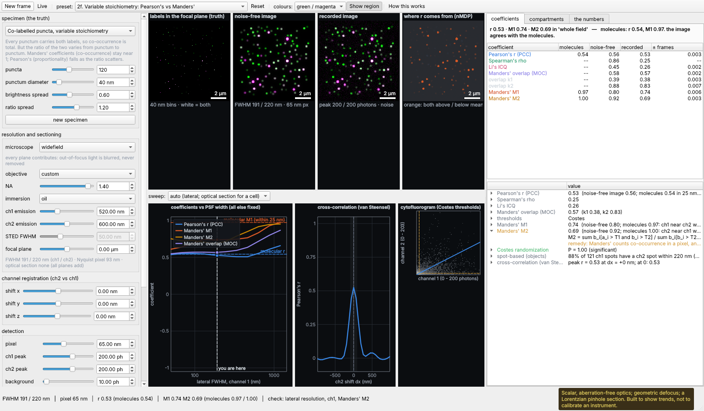
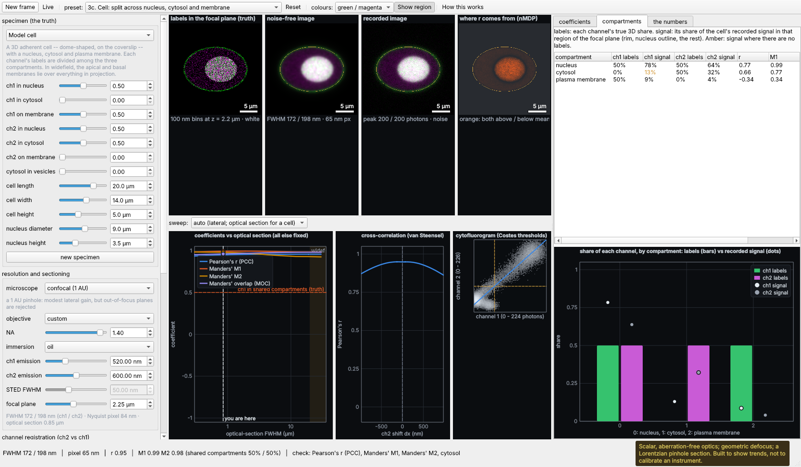
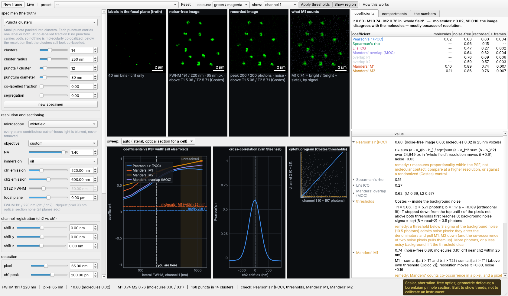
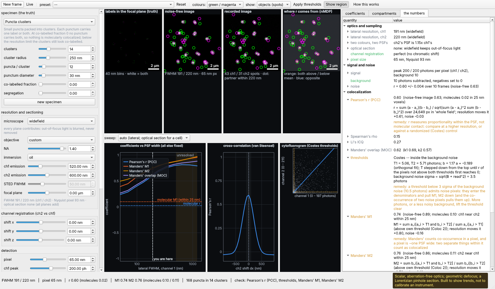

# ColocWidget

An interactive model of what **resolution** does to a **colocalization** measurement.
It is a companion to NoiseWidget and MicroscopeWidget and is built the same way: a
headless numpy model, a PySide6 front end, and every number shown with its equation
and your values in it.

Colocalization is a statement about distance, and an image cannot see distances
below its resolution. The widget places every label of both colours at a known
position, images the scene with the microscope you choose, and computes each
coefficient three times. Comparing the stages shows which step changed the answer:

| stage | what it is | the gap to the previous stage is... |
|---|---|---|
| **molecules** | computed from the label positions (within a distance you choose, 25 nm by default) | -- |
| **noise-free image** | after the optics (resolution, sectioning, registration) and the pixels | what **resolution** does |
| **recorded image** | with shot noise, background and read noise, over repeat frames | what **noise** does |



## The three cases

**1. Unresolved collections.** Many small puncta, each carrying one label, packed
into clusters smaller than the PSF. At widefield each cluster is one spot in both
colours, which looks like a single body carrying both labels. The *co-labelled
fraction* lever sets the true answer. Presets 1a–1d place the interleaved
specimen next to the truly co-labelled one, at widefield and at STED. The widefield
coefficients cannot tell the two specimens apart; the STED coefficients can.



**2. Distribution and morphology.** Each scene isolates one way the shape or
density of a distribution moves the coefficients:

| scene | what it shows |
|---|---|
| Adjacent filaments | two filaments a set distance apart: colocalized until the separation is resolved |
| Vesicles: membrane and lumen | a ring and its contents: the projected caps keep r high even at STED |
| Dense independent signals | unrelated molecules: r ≈ 0, but unthresholded M1/M2 → 1; a shared territory lifts r with no binding |
| Co-labelled puncta, variable stoichiometry | full co-occurrence, varying ratio: Manders' stays high while Pearson's falls |
| Exclusive domains | resolved: strongly negative r; below the resolution the exclusion fades toward r ≈ 0 |

Registration (chromatic shift in x, y and z), bleed-through and background
subtraction apply to every scene. Presets 2i and 2j show a chromatic shift
lowering r and moving the cross-correlation peak, and crosstalk raising r.



**3. Model cells and compartments.** The model cell is a 3D adherent cell (a dome on
the coverslip) with a nucleus, cytosol and plasma membrane. Each channel's labels
are split among the three compartments in proportions you set, and the cytosolic
pool can be partly vesicular. The coefficients can be measured over the whole field,
the cell, or one compartment. The **compartments** tab sets each channel's true
share in each compartment against its apparent share of the recorded signal there,
and gives r, M1 and M2 per compartment.

* In widefield, the apical and basal membranes lie over the whole cell. A membrane
  protein then appears mostly in the cytosol and over the nucleus. A confocal
  section returns it to the rim.
* Labels split across compartments give a whole-cell coefficient that averages
  several different answers. In preset 3c the bright, shared nucleus dominates, so
  r ≈ 0.95 even though half of each channel never meets the other.
* Out-of-focus cytosol contaminates a widefield nuclear ROI.
* Including the empty background in the ROI inflates r.

For cells the sweep switches to the **optical section** (axial), because that is
the resolution that separates compartments.



## The coefficients

| family | coefficient | what it measures |
|---|---|---|
| correlation | Pearson's r (PCC) | proportionality of the two intensities, mean-subtracted |
| | Spearman's rho | monotone association (Pearson's of the ranks) |
| | Li's ICQ | fraction of pixels whose deviations share a sign, −0.5…+0.5 |
| | van Steensel's CCF | r as channel 2 is shifted: peak position and width |
| co-occurrence | Manders' M1, M2 | fraction of each channel's signal where the other is present; thresholded, with the denominator over signal above its own threshold (Fiji's Coloc 2) or over all signal (Manders 1993) |
| | Manders' overlap (MOC), k1, k2 | not mean-subtracted, so background and uniform signal raise it |
| thresholds | Costes, Otsu, fixed fraction, none | which pixels count as "present" |
| significance | Costes randomization | r against channel 1 scrambled in PSF-sized blocks |
| objects | spot-based | fraction of local maxima with a partner within one FWHM, against the chance level 1 − exp(−ρπd²) |
| truth | molecular M1, M2 and r | from label positions: fraction within d, and r of label counts in d-sized voxels |
| | compartment overlap | share of each channel in compartments the other also occupies |

## What it shows

* **Four image panes**: the labels in the focal plane (the truth), the noise-free
  image, the recorded image, and a map of where Pearson's r comes from (normalized
  mean deviation product). Merges default to green/magenta; white means both.
* **Show** one channel alone across the top row, or the detected **objects**
  (spots ringed in their channel's colour; a white dot means a partner lies within
  one FWHM). With one channel shown, the last pane maps which of its pixels
  Manders' coefficient counts: bright pixels are in the numerator, slate pixels are
  in the denominator only.
* **Apply thresholds** (`Ctrl+T`) blanks every pixel below its channel's
  threshold (Costes by default), so the images show exactly what M1 and M2 count.




* **The sweep**: every coefficient plotted against the PSF width (or the optical
  section, for cells) with everything else fixed and your photon budget kept.
  Dashed lines mark the truth, and dots mark this frame. The **sweep x-axis** menu
  can put any numeric lever on the axis instead, or any parameter of the current
  scene (NA, pixel size, background, bleed-through, chromatic shift, the
  co-labelled fraction, cluster radius, a compartment weight, and so on). While a
  lever is on the plot, its control in the left pane is disabled and marked. When
  the sweep changes the specimen, or the distance that counts as "together", the
  truth is swept too and drawn as a dashed curve.
* **Cross-correlation** and the **cytofluorogram** (2D histogram, with the Costes
  fit and thresholds).
* **Coefficients** at all three stages, with the spread over repeat frames. **The
  numbers** gives each derived quantity with its equation and a remedy when
  something is off.

## The levers

| Group | Levers |
|---|---|
| Specimen | scene; every parameter that scene declares; new specimen |
| Resolution | microscope (widefield, confocal 1 AU, pixel reassignment, STED), objective, NA, immersion, emission wavelength per channel, STED FWHM, focal plane |
| Registration | channel 2 shift in x, y, z |
| Detection | pixel size, peak photons per channel, background, read noise, bleed-through, noise on/off |
| Analysis | region (whole field, cell, nucleus, cytosol, plasma membrane), threshold method, Manders' denominator, background subtraction, the distance that counts as "together", repeat frames |

There are 21 presets, numbered by case. Several come in pairs (widefield then STED,
whole cell then nucleus), so a comparison takes one click.

## Running it

```sh
pip install -e ".[ui]"
python -m colocwidget --ui                                 # open the widget
python -m colocwidget                                      # print the explained coefficients
python -m colocwidget --preset "1b. ... the same field at STED (50 nm)"
python -m colocwidget --set modality=STED --set colabelled=1
python -m colocwidget --set "scene=Model cell" --set roi=nucleus
python -m colocwidget --list-presets
python -m colocwidget --list-scenes                        # scenes and their parameters
```

`--set` accepts any lever and any parameter of the current scene. In the widget,
`Ctrl+R` records a new frame of the same scene, `Space` streams frames live,
`Ctrl+T` applies the thresholds to the images, and `F1` explains the layout.

### How Manders' coefficients are checked

`tests/test_metrics.py` checks M1 and M2 four ways:

* against a pixel-by-pixel loop, in both denominator forms;
* on a specimen with a known answer (half of channel 1's objects carry channel 2,
  so M1 ≈ 0.5 and M2 ≈ 1) under Costes, Otsu and fixed thresholds;
* for the classic pitfall: with no threshold, a noise-free blur reaches every
  pixel, so M1 → 1;
* for Costes' threshold: it must be the first crossing from the top, where r of
  the pixels not above both thresholds reaches 0.

On sparse, noisy images, Costes' thresholds often fall inside the background
noise. Noise pixels then enter the denominators and pull M1 and M2 down. The
thresholds row of the report flags this.

### Embedding

`ColocWidget` is a plain `QWidget`, so it can go in a tab or a dock:

```python
from colocwidget.ui.widget import ColocWidget
from colocwidget.physics.imaging import Levers

tabs.addTab(ColocWidget(Levers(na=1.4, modality="confocal (1 AU)")), "colocalization")
```

It emits `simulated(Simulation)` after every recompute and `summaryChanged(str)` for a
status bar. `set_levers(...)` lets a host push its own settings in.

## A note on the model

The optics are scalar and aberration-free. Lateral blur is the circular-pupil OTF
scaled to each modality's FWHM. Defocus is a geometric Gaussian, and the pinhole
is a Lorentzian plane-rejection with the 1 AU optical-section thickness. That is
enough to rank the effects correctly and show their size, but not enough to
calibrate an instrument. Each channel's brightness is set by its peak photons
rather than by photophysics. See [`docs/PLAN.md`](docs/PLAN.md) for the model
and its limits.

## Development

```sh
python -m venv .venv && . .venv/bin/activate
pip install -e ".[dev,ui]"
pytest -q
```

Everything outside `ui/` is importable and testable headless. The Qt tests run on the
offscreen platform, as CI does. `tests/test_imaging.py` states each preset's lesson as
an assertion. For example, the widefield M1 of interleaved and co-labelled puncta must
differ by less than their molecular truths do. A model change that breaks a lesson
fails CI.

### Building the executable

```sh
pip install "pyinstaller>=6.22"
pyinstaller packaging/colocwidget.spec --noconfirm
./dist/ColocWidget --list-presets   # smoke-test the frozen build
```

### Releases

The release workflow is the same as NoiseWidget's:

* `.github/workflows/ci.yml` runs the tests on Linux, macOS and Windows, on Python
  3.11 and 3.12, for every pull request and every push to `main`.
* `.github/workflows/release.yml` builds one self-contained executable each for
  Linux, Windows and both macOS architectures. It tests each build, runs the frozen
  binary, and then publishes:
  * a push to `main` becomes a **prerelease** tagged `build-<run number>`;
  * a pushed `v*` tag (`git tag v0.1.0 && git push origin v0.1.0`) becomes a
    **stable release**.

  Running the workflow by hand builds the artifacts without publishing them.
